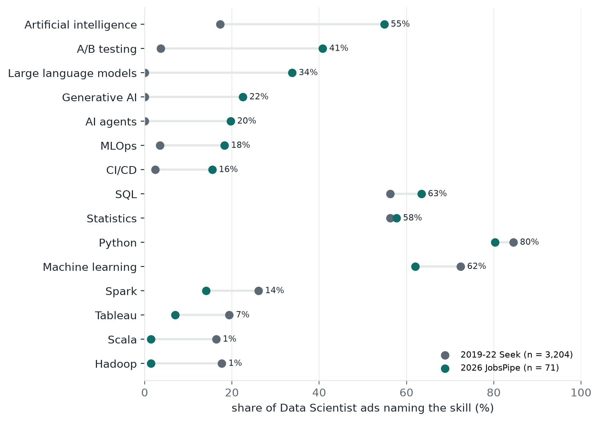

# 3 Data

Skillabus needs four kinds of data: job ads for demand, subject text for supply, resumes to test
the input side, and one skills vocabulary that ties them together. It covers 11 IT roles in five
families (data and AI, software, cloud and infrastructure, security, business analysis). Every
number below comes from `notebooks/vt_eda.ipynb`, which runs on committed files only, or from the
file named next to it; Appendix A lists every source with its licence, Appendix B every data file.

## 3.1 Sources

**Table 3.1.** The main sources (all sources and licences: Table A.1).

| Source | What we use | Period | Role in Skillabus |
|---|---|---|---|
| JobsPipe API (LinkedIn, Indeed and job boards) | 793 Australian ads, 63–79 per role; skills and links only | Sep–Oct 2026 | demand for every role |
| Adzuna API; 65 employers' public job boards | live search counts per skill and role; 392 ads, 85 with a role | Oct 2026 | two more 2026 views |
| Seek Australia (Kaggle, CC0) | 3,204 Data Scientist ads; 2,362 IT ads in 10 roles | 2019–22; 2020–21 | the trend before 2022 |
| ESCO, O\*NET, Australian Skills Classification | core skills of each role's occupation; base of the vocabulary | 2021–26 | roles and normalisation |
| Jobs and Skills Australia | 2025 Occupation Shortage List | 2025 | "in national shortage" label |
| UTS Handbook; students' Canvas reports | 360 subjects in 44 courses; 305 taught-skill rows for 9 MDSI subjects | 2026 | subject profiles |
| Resume Dataset (Kaggle, CC0) | 2,481 resumes | 2021 | test inputs |

Skills are found with **one vocabulary** (`data/1_knowledge/skills/skills_vocabulary.csv`, 504
rows): the 148 skills of our original dictionary, IT tools added from O\*NET, tool lists and the
2026 ads, the ESCO skills each occupation lists, and 49 certifications. ESCO is the base: every
skill keeps its ESCO link with a match grade, and every added one a reason. **Skillabus extends
ESCO with 145 skills that Australian ads ask for but ESCO lacks or names only as a wider concept**,
each named by at least 3 Australian ads from at least 2 employers (notebook section 10), among
them dbt, LangChain and prompt engineering.

## 3.2 Collection

We scraped none of Seek, LinkedIn, Indeed or Glassdoor, whose terms forbid it. Older ads come
from published datasets; 2026 ads come from APIs built to be read by software. JobsPipe is a
licensed aggregator whose terms forbid redistributing ad text, so we keep only the skills our
matcher finds in each ad and its link. Handbook pages were read one request at a time, at least
1.2 seconds apart. Section 7 discusses these choices.

## 3.3 Cleaning

The Seek ads had lost their spaces where HTML was stripped ("Power BI and TableauSuperior"); we
split a glued word only where the ad's second rendering shows a break (13,181 splits), which
raised Python from 82.8% to 84.5% of ads and left the ranking unchanged (rank correlation 0.9996).
For 2026 job-board ads we keep only ads posted within 60 days of the fetch and one per company and
title, because boards keep "evergreen" ads open for years. Emails and phone numbers are masked in
every ad file, and 1,146 names in the resumes, which are de-identified rather than anonymous. Two
traps would have misled a keyword matcher: UTS's peer-review tool SPARKPlus read as Apache Spark
in eight subjects, and a bare "AI" in ads that are not about the skill (recruiting tools, company
names). The tool name is now one word, and Artificial intelligence counts only in phrases such as
"AI models" or "AI/ML".

## 3.4 Subject profiles

Each of the 360 subjects is split into one row per sentence of text, labelled by layer: learning
objective, assessment task, weekly topic or description (6,853 rows; Table A.4). The assessment
layer, which the poster lacked, shows what students actually do: 36118 lists large language models
as a weekly topic, which its objectives never mention. A further 2,200 prerequisite items and 301
anti-requisite rows let a learning path respect order. The Handbook still under-states teaching:
62 dictionary skills are named by no subject, and the first two students' Canvas reports already
cover 28 of the 61 technical ones, among them TensorFlow, XGBoost and scikit-learn (notebook
section 7).

## 3.5 What employers ask for in 2026

**Table 3.2.** Top three skills per role, share of 2026 JobsPipe ads (notebook section 10).

| Role (ads) | Top skills |
|---|---|
| Data Scientist (71) | Python 80%, SQL 63%, Machine learning 62% |
| Data Analyst (78) | SQL 69%, Data quality 53%, Data visualisation 46% |
| Data Engineer (70) | SQL 87%, ETL 81%, Python 71% |
| Machine Learning Engineer (69) | Artificial intelligence 87%, Python 80%, Cloud platforms 68% |
| Software Engineer (73) | Cloud platforms 53%, Teamwork 52%, JavaScript 42% |
| QA/Test Engineer (78) | Test automation 64%, Agile 51%, Teamwork 45% |
| Cloud Engineer (63) | Cloud platforms 100%, Terraform 79%, Azure 75% |
| DevOps/SRE (67) | Cloud platforms 81%, CI/CD 72%, Terraform 70% |
| Network/Systems Administrator (77) | Documentation 52%, Teamwork 44%, Cloud platforms 43% |
| Cybersecurity Analyst (68) | Cyber security 81%, Incident response 59%, Cloud platforms 53% |
| Business Analyst (79) | Stakeholder management 73%, Requirements gathering 58%, Documentation 57% |

*Figure 3.1. Share of Data Scientist ads naming each skill: 3,204 Seek ads of 2019–22 against 71
JobsPipe ads of 2026, same matcher and vocabulary. Labels give the 2026 share.*

Figure 3.1 shows the shift that motivates Skillabus. The core holds: Python, SQL and statistics
are asked for as often in 2026 as in 2019–22. Around it, the LLM era has arrived: large language
models went from no ad to 34% of Data Scientist ads (95% Wilson interval 24–45%), generative AI to
22% and AI agents to 20%, while Hadoop and Scala fell from 18% and 16% to one ad each. The shift
is not limited to data scientists: 61% of Machine Learning Engineer ads name large language models,
and 10% of Software Engineer ads do. With about 70 ads per role, one ad moves a share by 1.4
points and the intervals are about ±11 points, so we report directions and large differences
only.

## 3.6 Can the counts be trusted?

Two annotators labelled the same 20 ads independently and agree with a Cohen's kappa of 0.856 on
dictionary skills (0.686 including free-text labels), so the test labels in section 6 are
reliable. On the Seek ads, our matcher agrees with the dataset author's own tool flags with a
median kappa of 0.637 over 14 tools; most disagreements are the author's flags firing on ads
that never name the tool. Rankings hold across platforms and periods: rank correlation 0.75
with Glassdoor Australia and 0.82 with LinkedIn US, and 0.40–0.97 between live Adzuna counts and
the 2023 tool lists of seven roles (Table A.3). Shares from different kinds of source are not
comparable, though: Python is in 80% of 2026 Data Scientist ads but 59% of 2023 tool lists, so
the app always shows a share with its source, period and number of ads. Limits of the data are
in section 7.

## References

Barousse, L. (2025). *data_jobs* [Data set]. Hugging Face. https://huggingface.co/datasets/lukebarousse/data_jobs

Cohen, J. (1960). A coefficient of agreement for nominal scales. *Educational and Psychological Measurement, 20*(1), 37–46. https://doi.org/10.1177/001316446002000104

European Commission. (2025). *ESCO: European skills, competences, qualifications and occupations* (Version 1.2.1) [Data set]. https://esco.ec.europa.eu/en/use-esco/download

JobsPipe. (2026). *JobsPipe job search API* [API]. https://jobspipe.dev

Jobs and Skills Australia. (2025). *2025 Occupation Shortage List* [Data set]. Commonwealth of Australia. https://www.jobsandskills.gov.au/data/occupation-shortage

National Center for O\*NET Development. (2026). *O\*NET 31.0 database* [Data set]. https://www.onetcenter.org/database.html

National Skills Commission. (2021). *Australian Skills Classification* (Version 1.0) [Data set]. Commonwealth of Australia.

nomilk. (2022). *Data science job listings – Australia – 2019–2021* [Data set]. Kaggle. https://www.kaggle.com/datasets/nomilk/data-science-job-listings-australia-20192020

PromptCloud. (2021a). *Seek Australia job listing* (Oct–Dec 2020) [Data set]. Kaggle. https://www.kaggle.com/datasets/promptcloud/seek-australia-job-listing

PromptCloud. (2021b). *Seek job listing Australia* (Jan–Mar 2021) [Data set]. Kaggle. https://www.kaggle.com/datasets/promptcloud/seek-job-listing-australia

snehaanbhawal. (2021). *Resume dataset* [Data set]. Kaggle. https://www.kaggle.com/datasets/snehaanbhawal/resume-dataset

University of Technology Sydney. (2026). *UTS handbook 2026*. https://coursehandbook.uts.edu.au

Wilson, E. B. (1927). Probable inference, the law of succession, and statistical inference. *Journal of the American Statistical Association, 22*(158), 209–212. https://doi.org/10.1080/01621459.1927.10502953
