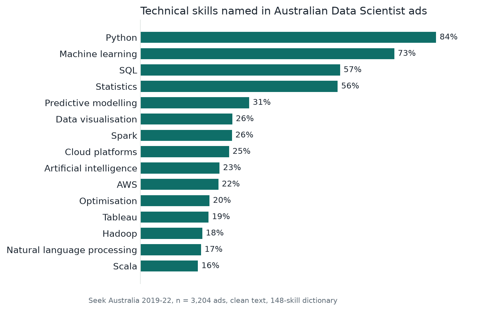
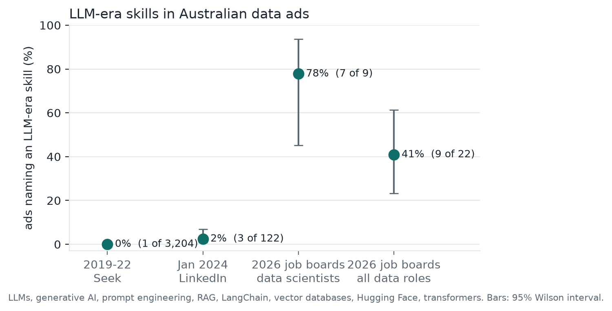
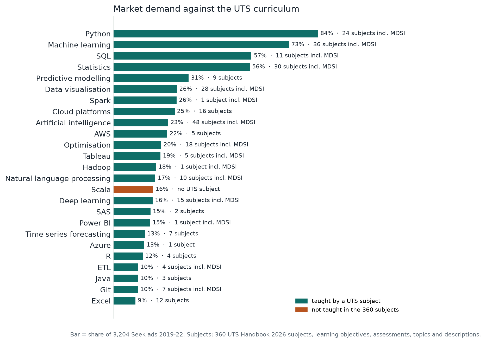

# 3 Data

> Draft by Van Thong (with Claude), updated 14 Oct 2026. Every number below comes from
> `notebooks/vt_eda.ipynb`, which runs on committed files only, or from the file named next
> to it. The script behind each file is named in `data-eda/data/clean/README.txt` and
> `data/README.md`. The 2026 job-board sample is re-collected daily until 16 Oct, so its
> counts in section 3.7 may still move by an ad or two.

## 3.1 Sources

Skillabus needs four kinds of data: job ads for demand, subject text for supply, resumes
to test the input side, and a skills vocabulary that ties them together. Table 3.1 lists
every source and what it is used for.

**Table 3.1.** Data sources.

| Source | What we use | Period | Role in Skillabus |
|---|---|---|---|
| Seek Australia Data Scientist ads (nomilk, 2022) | 3,204 listings, full text | Feb 2019 – Jan 2022 | demand: every `demand_pct` |
| Public job-board APIs of 65 employers (Greenhouse, Lever, SmartRecruiters, Ashby, Workable) | 22 Australian data roles in the sample, 9 of them data scientists; full text | Sep – Oct 2026 | recent demand: `demand_pct_2026`, trend, emerging skills |
| Adzuna API | 32 Australian data roles, text cut at 500 characters | Sep 2026 | counted as roles, not for skill shares |
| LinkedIn data-science postings (asaniczka, 2024) | 122 Australian data roles | Jan 2024 | midpoint for the trend |
| LinkedIn job postings (arshkon, 2024) | 247 US Data Scientist ads | 2023–24 | validation |
| Glassdoor Australia (nadzmiagthomas, 2022) | 193 data roles | Aug – Dec 2022 | validation |
| Data job postings (Barousse, 2025) | 10,925 Australian postings in 7 data and IT roles; tool lists, no text | 2023 | role profiles for roles other than Data Scientist |
| UTS Handbook 2026 (University of Technology Sydney, 2026) | 360 subjects in 44 courses, 19 of them MDSI | 2026 | subject profiles, prerequisites, teaching sessions |
| Official course and tutorial pages (42 providers) | 56 free or free-to-audit courses | Oct 2026 | second tier of the learning path |
| Resume Dataset (snehaanbhawal, 2021) | 2,481 resumes, 24 categories | 2021 | test inputs, CV–JD pairs |
| ESCO v1.2.1 (European Commission, 2025) | 13,960 skills, 100,135 labels | 2025 | normalisation vocabulary |
| O\*NET 31.0 (National Center for O\*NET Development, 2026) | 8,753 tool names | 2026 | tools ESCO lacks |

Skills are first found with a 148-skill dictionary (`data/processed/skills_seed_v2.csv`)
written from the way ads phrase things, so "power bi", "powerbi" and "Power BI" are one skill.
Ten tool rows (Kafka, Linux, Jira, SAP and others) were added on 14 Oct for the IT roles; none
of them reaches 5% of the Seek ads, so the demand ranking is unchanged.

## 3.2 Collection and ethics

We scraped none of Seek, LinkedIn, Indeed or Glassdoor: their terms forbid automated
access. Every job ad comes from a published dataset or a public job-board API built to be
read by software. Indeed was in the plan and was dropped for this reason; it has no public
search API. The 2023 postings dataset is published under the Apache-2.0 licence; we publish
only per-role shares from it, never a posting.

The UTS Handbook's `robots.txt` disallows crawling. We read the 360 subject pages, one data
request per subject for its assessment tasks, and the public access-conditions page for its
prerequisites, one request at a time and at least 1.2 seconds apart, with a user agent that
names the project. When three scrapers once ran in parallel, the Handbook's content network
blocked us for about four minutes; since then only one scraper runs at a time. The external
course pages were each requested once, and only their short descriptions and module titles
are kept, with the link.

Resumes are de-identified (section 3.3) before any use, and the app masks names again
before any text reaches a language model. Recruiters' emails and phone numbers in the
recent-ads file (63 and 24, mostly in the 2024 LinkedIn ads) are masked as well; recruiters'
names stay as published.

## 3.3 Cleaning

**Welded words in the Seek ads.** The source dataset stripped HTML without putting spaces
back, so list items ran together ("…Power BI and TableauSuperior analytical skills…") in
80.4% of ads, and a dictionary with word boundaries misses those mentions. Each ad is
stored twice in the dataset, as a mobile and a desktop page. We split a join only where
the other version of the same ad shows a break: 13,181 joins were split and 11,574 left
alone, almost all genuine product names such as PhD, TensorFlow, PySpark and JavaScript.
Python rose from 82.8% to 84.5% of ads, no skill fell, and the ranking barely moved (rank
correlation 0.9996 with the uncleaned counts).

**Re-listings.** 697 listings repeat another listing's text exactly. In 99% of cases the
employer is the same and the ad was posted again on a later date (81%) or in another city
(19%), so there are 2,507 unique ads. We count per listing, as on the poster; counting per
unique ad moves no skill by more than 2.1 points (rank correlation 0.997). The 200-ad
labelling sample is drawn so that no text appears twice.

**Resumes.** Emails (in 19 resumes), phone numbers (62) and URLs (101) are masked with
patterns; the phone pattern allows spaces around a dash ("(281) 491 - 3225"). Names are
harder: spaCy's named-entity recogniser (Honnibal et al., 2020) tags 16,451 spans as people,
but most are resume vocabulary ("Developed") or skills ("Java", "Oracle"). A span is masked
only if it is two or more capitalised words, starts with a known first name, occurs in at
most two resumes, and is not a dictionary skill or an O\*NET tool. A first-name list misses
many South Asian names, so referees also lose their names after a title ("Dr. [NAME]") or
before a credential ("[NAME], RN"). In all, 1,146 names are masked in 551 resumes, and every
skill count is unchanged (whole-word Java: 170 mentions in 64 resumes before and after). The result is de-identified, not anonymous.

**ESCO and the Handbook.** ESCO keeps alternative labels as a newline-separated list
inside one cell; we reshaped it into a lookup of 100,886 label–concept rows. 716 labels
(0.7%) point at more than one concept, including `sql` ("SQL" and "database management
systems"), so a lookup alone cannot normalise them. In the Handbook text, broken
punctuation and course-level outcome codes were removed. Two kinds of assessment text would
have misled a keyword matcher. Subjects state their policy on AI tools ("generative AI tools
are not permitted"), and 29 of 30 such mentions were policy rather than content, so those
sentences are dropped. The assessments of 19 subjects name UTS's peer-review tool SPARKPlus,
and in eight of them its spelling ("SPARK Plus", "Spark+", "SPARK") was read as Apache Spark. It
is now written as one word, and Spark is matched in one subject (94693) instead of nine
(notebook section 7).

## 3.4 Subject profiles

The poster feedback pointed out that learning objectives alone miss what a subject
teaches. Each subject is therefore split into one row per piece of text, labelled by layer
(Table 3.2), so a recommendation can quote the exact sentence and say where it came from.

**Table 3.2.** Subject profiles (`data/processed/subject_profiles.csv`, 6,853 rows, 360 subjects).

| Layer | Rows | Subjects | Source |
|---|---|---|---|
| Learning objective | 1,516 | 354 | one row per objective |
| Assessment | 1,015 | 326 | one row per task: name, type, weight, group or individual, description |
| Weekly topic | 2,769 | 327 | one row per listed topic |
| Description | 1,553 | 360 | one row per sentence |

The 360 subjects come from 44 courses: the data, IT, AI, analytics and mathematics masters,
graduate certificates and diplomas, and the matching bachelor and honours degrees. The
assessment layer was the one the poster lacked. The Handbook shows tasks only after a
teaching period is chosen, and the page then requests them as data; we made that request
directly for each subject. Alongside the profiles, `prerequisites.csv` holds 2,208
requisite items for 290 subjects (70 further rows mark subjects with no rule) and each
subject's anti-requisites, and `offerings.csv` lists the teaching sessions of 330 subjects,
so a learning path can respect order and timing.

The extra layers matter. Subject 36118 Applied NLP lists "Large Language Models (LLMs)" as
a weekly topic, which its learning objectives never mention, and 43007's assessment asks for
an LLM-based system. Coverage is still uneven within MDSI: 16 of its 19 subjects have
assessment tasks, but 9 have no topic list, including 36106 Machine Learning and 94691 Deep
Learning, and three (36124, 36125, 94689) have neither tasks nor learning objectives. Those
subjects can rank low for lack of text rather than lack of content.

## 3.5 What the market asks for

*Figure 3.1. Share of the 3,204 Seek ads naming each technical skill.*

Four skills dominate: Python (84%), machine learning (73%), SQL (57%) and statistics (56%).
After them only predictive modelling passes 30%, and 24 technical skills appear in at least
10% of ads. A typical ad names eight technical skills (interquartile range 5–11), and 32% ask
for all of Python, SQL and statistics. Communication appears in 30% of ads, more often than
any technical skill outside the top five. The app's demand figures
(`data/processed/skill_counts_v2.csv`) are the poster's counts on the uncleaned text; they are
within 1.7 points of Figure 3.1 and rank skills the same way (rank correlation 0.9991 over
the 123 technical skills named in both; notebook section 3).

## 3.6 Can the counts be trusted?

**An independent extractor.** The Kaggle dataset includes its author's own flags for 25
tools on the same ads. On the 14 tools both extractors cover, agreement across all 3,204 ads
gives a median Cohen's kappa (Cohen, 1960) of 0.637, with 8 of 14 at 0.60 or above. The two
mostly disagree in one direction: for 3,348 of the author's 3,734 extra positives, the tool
does not appear in the ad at all (their R flag fires on 70% of ads). Our own misses were
mainly the welded words fixed in section 3.3. This measures agreement, not accuracy;
accuracy comes from the hand-labelled test set in section 6. Its two annotators labelled the
same 20 ads independently (`data/labels/ad_skills.csv`) and agree with a Cohen's kappa of 0.856
on dictionary skills (20 ads × 148 skills, 2,960 items) and 0.686 when free-text labels are
included (4,580 items), computed with the evaluation harness's `annotator_agreement` (notebook
section 4).

**Other platforms and markets.** If the ranking were an artefact of how Seek ads are
written, other sources would rank skills differently. Table 3.3 compares them, using the
Spearman rank correlation over technical skills that appear in both corpora.

**Table 3.3.** Skill ranking compared with Seek Australia, 2019–22.

| Compared with | Ads | What differs | Rank correlation |
|---|---|---|---|
| Glassdoor Australia, 2022 | 193 | platform | 0.75 |
| LinkedIn US, 2023–24, Data Scientist titles | 247 | country and years | 0.82 |
| LinkedIn Australia, Jan 2024, data roles | 122 | years and role mix | 0.61 |

The ranking holds across platforms and countries. It is weakest where the role mix
changes: the January 2024 sample is mostly data engineers and analysts.

## 3.7 Recent ads and the LLM shift

The plan asked for about 150 Australian ads from 2026. Seek, LinkedIn and Indeed forbid
scraping, so we listed 206 candidate employers (`data-eda/config/ats_candidates.csv`) and probed
their boards on five public job-board APIs: 94 boards at 89 employers answered with jobs
(`data-eda/data/clean/ats_probe_2026-10-13.csv`), and the 65 with Australian roles
(`data-eda/config/ats_companies.csv`) are fetched daily. A 2026 ad counts only if its
title is a data role (sales roles that sell analytics are excluded), it was posted within 60
days of the day it was fetched, and its employer has not already given three. Twelve older
ads, kept open for months, were dropped this way. The sample is 22 ads: 9 data-scientist
titles from 5 employers, the like-for-like group for the Seek file, and 13 other data roles.
Adzuna adds 32 roles, but its API cuts every description at 500 characters, so they are
excluded from skill shares. All periods use the same dictionary, cleaning and code
(`data/processed/skill_counts_2026.csv`).

*Figure 3.2. Australian data ads naming an LLM-era skill, with 95% Wilson intervals (n = 3,204; 122; 9; 22).*

LLM-era skills went from one ad in 3,204 to 3 of 122 in early 2024 (2.5%), then to 7 of the
9 data-scientist ads of 2026 (78%; 95% Wilson interval 45–94%; Wilson, 1927) and 9 of all 22
(41%; 23–61%). Part of the jump is the role mix, because AI and ML engineers mention LLMs by
definition, but the rise appears within both groups: from 1 of 108 to 4 of 14 for titles
without AI or ML, and from 2 of 14 to 5 of 8 for AI and ML titles.

**Table 3.4.** Skills whose 2019–22 share lies outside the 95% interval of the 2026
data-scientist share (n = 9; technical skills named in at least 3 of the 9 ads, or above 20% in 2019–22).

| Skill | 2019–22 (n = 3,204) | Jan 2024 (n = 122) | 2026 data scientists (n = 9) | 2026 all data roles (n = 22) |
|---|---|---|---|---|
| Artificial intelligence | 22.6% | 19.7% | 8 of 9 | 86% |
| Large language models | 0.0% | 1.6% | 6 of 9 | 36% |
| A/B testing | 3.7% | 17.2% | 4 of 9 | 41% |
| Google Cloud | 8.6% | 14.8% | 4 of 9 | 32% |
| ETL | 10.2% | 32.0% | 3 of 9 | 45% |
| Generative AI | 0.0% | 1.6% | 3 of 9 | 14% |
| Predictive modelling | 31.1% | 9.8% | 0 of 9 | 0% |

The direction is clear, the sizes are not: with 9 ads, one ad moves a share by 11 points.
The app therefore keeps the 2019–22 shares as its demand
weights. The 2026 shares feed the "emerging" flag, read over all 22 roles, and a trend column
that shows the data-scientist count ("6 of 9 recent ads"). Eight LLM tools and vendors appear
only in the 2026 ads and are not in our dictionary, among them LangGraph, LangSmith, GraphRAG
and Claude;
these are the skills normalisation tags as emerging (section 4).

**Roles beyond Data Scientist.** The Seek file has Data Scientist titles only. For six other
roles (data engineer, data analyst, software, business analyst, cloud and machine-learning
engineer) the app uses a 2023 dataset of 10,925 Australian postings whose author lists the
tools each ad names (`data/processed/role_profiles.csv`). Data engineers ask most for SQL
(69%), Python (57%), Azure (43%) and AWS (42%); cloud engineers for Azure (42%), AWS (38%) and
Terraform (20%). The lists hold tools only, so concepts such as machine learning never
appear, and Data Scientist keeps the Seek profile. The dataset's own extractor also counts the
English word "go" as the Go language, so Go is counted only from "golang".

## 3.8 Market against curriculum

*Figure 3.3. The 25 most-demanded technical skills (share of the 3,204 Seek ads), coloured by
whether any of the 360 UTS subjects names them.*

24 of the 25 most-demanded technical skills are named by at least one of the 360 subjects,
and 15 by an MDSI subject. Only Scala is named by none. Naming is not depth, though: Spark
and Hadoop appear only in 94693 and Power BI only in 36104 (both MDSI), while Azure appears in
one subject and AWS in five, none of them in MDSI. "Named" is a keyword match, so it can over-count: three of Excel's
twelve subjects use "excel" as a verb. The LLM toolchain is still the clearest gap. Large
language models appear as topics in 36118, 41180 and 43023 and in an assessment of 43007,
and generative AI in five subjects, but prompt engineering and retrieval-augmented
generation appear in none of the 360. For the 62 dictionary skills that no subject names
(61 of them technical, led by Scala, Google Cloud and TensorFlow; notebook section 7), the
app's second tier draws on the 56 external courses.

On the input side, only 125 of the 2,481 resumes name two or more of six core data skills,
and none of the 24 categories is data science. The CV–JD test pairs are drawn from those
125, and the app's demonstration uses a synthetic MDSI resume.

## 3.9 Limitations

- The main corpus is Data Scientist titles only, ends in January 2022, and is 22% re-listings.
- The 2026 sample is 22 ads, 9 of them data scientists from 5 employers, all from employers
  with a public job board, which leaves out banks, government and universities. It supports
  a direction, not precise shares.
- The other six roles rest on 2023 tool lists, not ad text, extracted by the dataset's author.
- The resumes are US, from 2021, mostly outside data roles, and de-identified rather than anonymous.
- Subject profiles come from the public Handbook; topic lists are uneven, and three MDSI
  subjects have description text only. Coverage is a keyword match, not a judgement of depth.
- Only 36% of our dictionary maps to ESCO by exact label, and some ESCO labels are ambiguous.
- A dictionary misses new tools until someone adds them, and it under-counts R and Go on
  purpose (a bare "R" matches "R&D").

## References

arshkon. (2024). *LinkedIn job postings (2023–2024)* [Data set]. Kaggle. https://www.kaggle.com/datasets/arshkon/linkedin-job-postings

asaniczka. (2024). *Data science job postings & skills (2024)* [Data set]. Kaggle. https://www.kaggle.com/datasets/asaniczka/data-science-job-postings-and-skills

Barousse, L. (2025). *data_jobs* [Data set]. Hugging Face. https://huggingface.co/datasets/lukebarousse/data_jobs

Cohen, J. (1960). A coefficient of agreement for nominal scales. *Educational and Psychological Measurement, 20*(1), 37–46. https://doi.org/10.1177/001316446002000104

European Commission. (2025). *ESCO: European skills, competences, qualifications and occupations* (Version 1.2.1) [Data set]. https://esco.ec.europa.eu/en/use-esco/download

Honnibal, M., Montani, I., Van Landeghem, S., & Boyd, A. (2020). *spaCy: Industrial-strength natural language processing in Python*. Zenodo. https://doi.org/10.5281/zenodo.1212303

nadzmiagthomas. (2022). *Australia data science jobs* [Data set]. Kaggle. https://www.kaggle.com/datasets/nadzmiagthomas/australia-data-science-jobs

National Center for O\*NET Development. (2026). *O\*NET 31.0 database* [Data set]. https://www.onetcenter.org/database.html

nomilk. (2022). *Data science job listings – Australia – 2019–2021* [Data set]. Kaggle. https://www.kaggle.com/datasets/nomilk/data-science-job-listings-australia-20192020

snehaanbhawal. (2021). *Resume dataset* [Data set]. Kaggle. https://www.kaggle.com/datasets/snehaanbhawal/resume-dataset

University of Technology Sydney. (2026). *UTS handbook 2026*. https://coursehandbook.uts.edu.au

Wilson, E. B. (1927). Probable inference, the law of succession, and statistical inference. *Journal of the American Statistical Association, 22*(158), 209–212. https://doi.org/10.1080/01621459.1927.10502953
