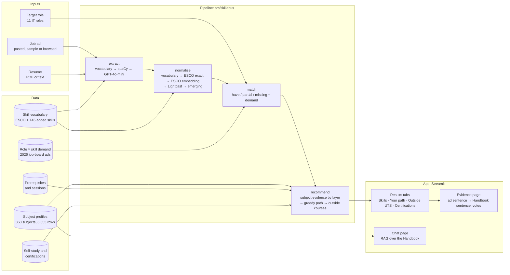

# 5 System

> Phuong Nhi, 17 Oct 2026, rewritten for the app after #143 and #150 (#158). Code: `src/skillabus/` (pipeline),
> `app/` (Streamlit). Screenshots: `docs/report/figures/`.

## 5.1 Architecture



**Figure 5.1** The pipeline and the data each stage reads.

The app calls the pipeline through one module (`app/backend.py`). If a stage fails, it falls back to a dictionary-and-
keyword baseline that returns the same JSON (`docs/data_contract.md`), and the page says which engine produced the
result. Without an OpenAI key everything except the GPT-4o-mini tier and the chat's written answers still runs. The free
Streamlit host has no PyTorch, so the deployed app uses the TF-IDF paths for subject evidence and chat retrieval.

## 5.2 What a user sees

A bar at the top shows the three steps (who you are, inputs, results) and opens the chat.

1. **Start.** Three users: a *UTS student* choosing electives for a role, a *job seeker* checking a resume against one
   ad, and a *career switcher* measuring the distance to a new field.
2. **Inputs.** A role (11 IT roles, grouped by field) or an ad (browse 2026 ads, paste one, or try the sample), the
   resume, and the subjects already taken.
3. **Results** (Figure 5.2), one tab at a time:
   - *Skills*: how many of the asked-for skills are missing, a bar per skill with its share of 2026 ads (the 2019–22
     share on hover), and emerging skills marked ✦;
   - *Your path*: the 2–3 UTS subjects that close the most demand, with prerequisites and sessions;
   - *Outside UTS*: self-study courses for gaps no subject covers, marked as not for credit, with level and cost;
   - *Certifications* (role modes), from foundational to expert.
4. **Evidence** (Figure 5.3). For each gap, the ad sentence beside the Handbook sentence that justifies each subject,
   with the layer it came from (learning objective, assessment, weekly topic, description). Students can vote "teaches
   it" or "not really", and tick "I've taken it" to see the path without that subject.
5. **Chat.** Questions about subjects, answered from Handbook passages with citations.

**Figure 5.2** Results for the sample Data Scientist ad and resume. **[screenshot: Skills tab, then Your path tab]**

**Figure 5.3** Evidence for one missing skill. **[screenshot: evidence page]**

## 5.3 How to run it

```bash
python -m venv .venv && source .venv/bin/activate
pip install -r requirements.txt
cp .env.example .env          # optional: OPENAI_API_KEY for the GPT tier and the chat
streamlit run app/Home.py
```

The evaluation reruns with `python -m skillabus.evaluate --all`; GPT answers are read from a committed cache, so only the
chat judge needs a key. The deployed app and its QR code are in the appendix.
