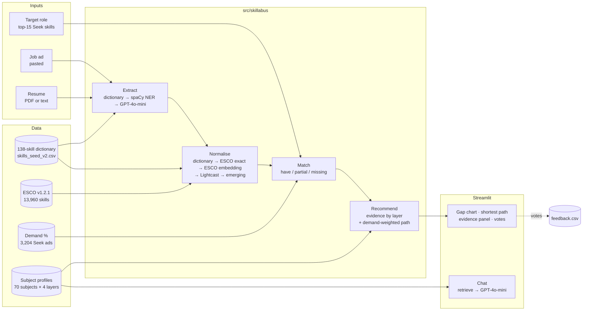

# 5 System

> Draft by Quan (with Claude), 4 Oct 2026. Screens: `docs/wireframes/`. Code: `app/`, `src/skillabus/`.

## 5.1 Architecture

One seam connects the app to the pipeline (`app/backend.py`). It runs the pipeline stages and,
if one is not built yet or fails, falls back to a dictionary-and-keyword baseline that returns
the same JSON (`docs/data_contract.md`). The page states which engine produced the result, so a
demo never breaks and a reader always knows which method they are looking at.

## 5.2 Design choices

| Choice | Reason |
|---|---|
| Every skill the LLM returns must occur verbatim in the text; the evidence sentence is cut from the text, not generated | The model cannot invent skills or quotes, which keeps the evidence panel honest |
| Generative AI and LLMs skip the ESCO steps of normalisation | ESCO v1.2.1 has no concept for them; an embedding would force them onto a loosely related concept. They are kept and flagged ✦ instead |
| Hand-checked blocklist of wrong ESCO concepts | ESCO "SPARK" is a Java web framework, not Apache Spark; our dictionary's link to it was wrong (section 6) |
| Learning path: greedy set cover weighted by `demand + 1` | Picks subjects by employer demand, not keyword hits; the +1 keeps 0%-demand skills (LLMs in 2019-22 ads) in play |
| Each gap keeps its two strongest subjects in the result | A low-demand gap still shows its evidence |
| Thumbs up/down per subject-skill pair, with "I've taken it" | Turns users into validators of the subject mapping (section 6) |
| Resumes stay in memory; emails, phones and URLs are masked before any LLM call; resumes never reach the chat | Privacy (section 7) |
| Responses cached by hash of model + prompt + text | Repeatable evaluation at near-zero cost |

## 5.3 Screens

1. **Start**: choose elective chooser, job seeker or career switcher.
2. **Inputs**: ad or target role, resume, subjects already taken.
3. **Results**: "6 of 8" headline, gap chart, shortest path.
4. **Evidence**: ad sentence beside subject sentence, layer label, vote.
5. **Chat**: Handbook-grounded answers with cited subjects.

**[Figure: screenshots 03 and 04 side by side; QR code to the deployed app.]**
