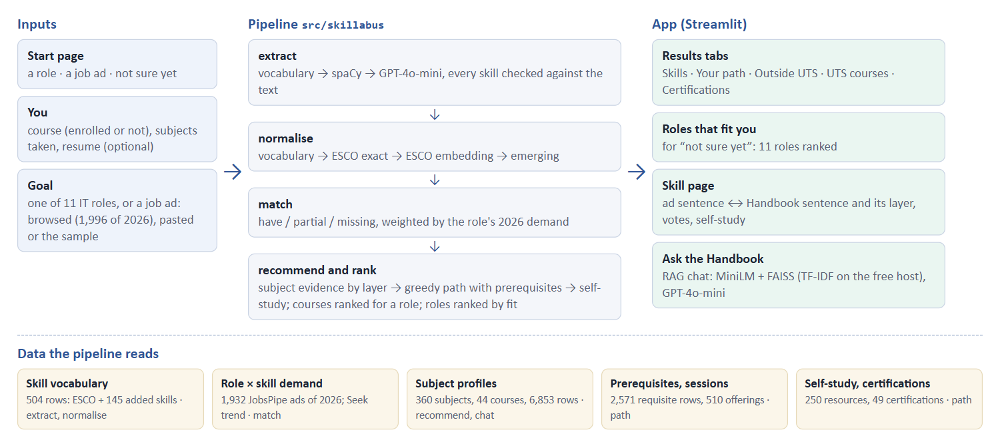
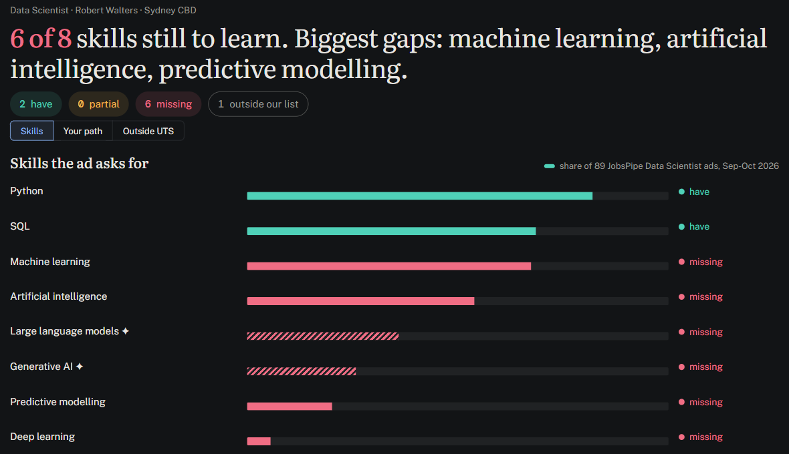
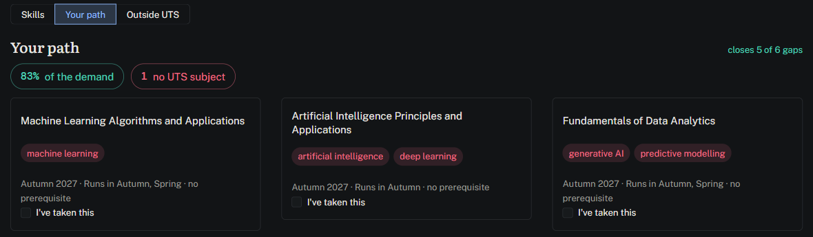
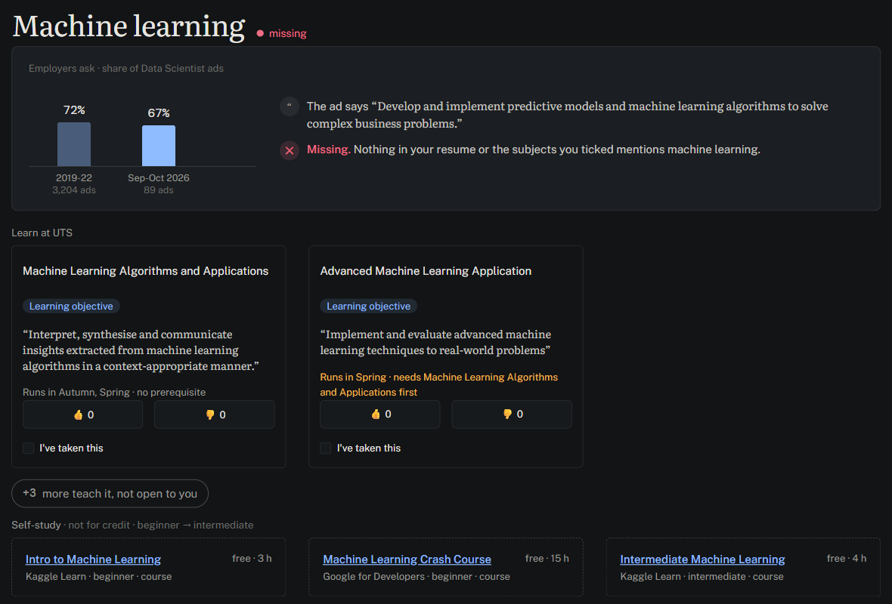

# 5 System

## 5.1 Architecture

**Figure 5.1** The pipeline and the data each stage reads.

The app calls the pipeline through one module (`app/backend.py`). If a stage fails, it falls back to a dictionary-and-keyword baseline that returns the same JSON (`docs/data_contract.md`), and the page says which engine produced the result. Without an OpenAI key everything except the GPT-4o-mini tier and the chat’s written answers still runs. The free Streamlit host has no PyTorch, so the deployed app uses the TF-IDF paths for subject evidence and chat retrieval.

## 5.2 What a user sees

A bar at the top shows the two steps (inputs, results) as links and an “Ask the Handbook” button that opens the chat.

1.  **Start.** One line on what the app does, the size of its data and three doors that preset the goal: “I know the role I want”, “I have a job ad” and “I’m not sure yet”.
2.  **Inputs.** Enrolled at UTS or not yet; the course (it decides which subjects are open) and the subjects already taken; an optional resume; and the goal: a role (11 IT roles, grouped by field), an ad (browse 1,996 ads of 2026, paste one, or try the sample) or “not sure yet”, which first ranks the 11 roles by fit.
3.  **Results** (Figure 5.2), one tab at a time:
    - *Skills*: how many of the asked-for skills are missing, a bar per skill with its share of the role’s 2026 ads (the pre-2022 Seek share on hover), and emerging skills marked ✦;
    - *Your path*: the 2–3 UTS subjects that close the most demand, with prerequisites and sessions;
    - *Outside UTS*: self-study courses for gaps the UTS path leaves open, marked as not for credit, with provider and cost;
    - *Certifications* (when the goal is a role), from foundational to expert, and UTS courses: the 44 courses ranked for the role, the student’s own marked.
4.  **Skill page** (Figure 5.3). For each gap: its share of the role’s 2026 ads next to its pre-2022 Seek share, the ad’s sentence (when the goal is an ad), and why it is missing; below, a row of UTS subject cards, each with the Handbook sentence that justifies it and the layer it came from (learning objective, assessment, weekly topic, description), then up to three self-study cards, beginner first. Students can vote on whether a subject really teaches the skill, and an “I’ve taken this” tick adds the subject to the Inputs list, counts its skills as had and recomputes the gaps and the path.
5.  **Chat.** Questions about subjects, answered from Handbook passages with citations.

**Figure 5.2** Results for the sample Data Scientist ad and resume: the Skills tab (top; bars are the share of the 89 Data Scientist ads of 2026, hatched bars mark emerging skills) and the Your path tab (bottom; three subjects close 5 of 6 gaps, 83% of the demand-weighted gap, with sessions and prerequisites).

**Figure 5.3** The skill page for machine learning: 72% of the 3,204 Seek ads of 2019–22 and 67% of the 89 Data Scientist ads of September–October 2026 ask for it; the ad’s sentence and why it counts as missing; the two UTS subjects open to an MDSI student, each with the learning objective that justifies it (three more teach it but are not open); and self-study from beginner to intermediate.

## 5.3 How to run it

    python -m venv .venv && source .venv/bin/activate
    pip install -r requirements.txt
    cp .env.example .env          # optional: OPENAI_API_KEY for the GPT tier and the chat
    streamlit run app/Home.py

The evaluation reruns with `python -m skillabus.evaluate --all`; GPT answers are read from a committed cache, so only the chat judge needs a key. The deployed app and its QR code are in the appendix.
